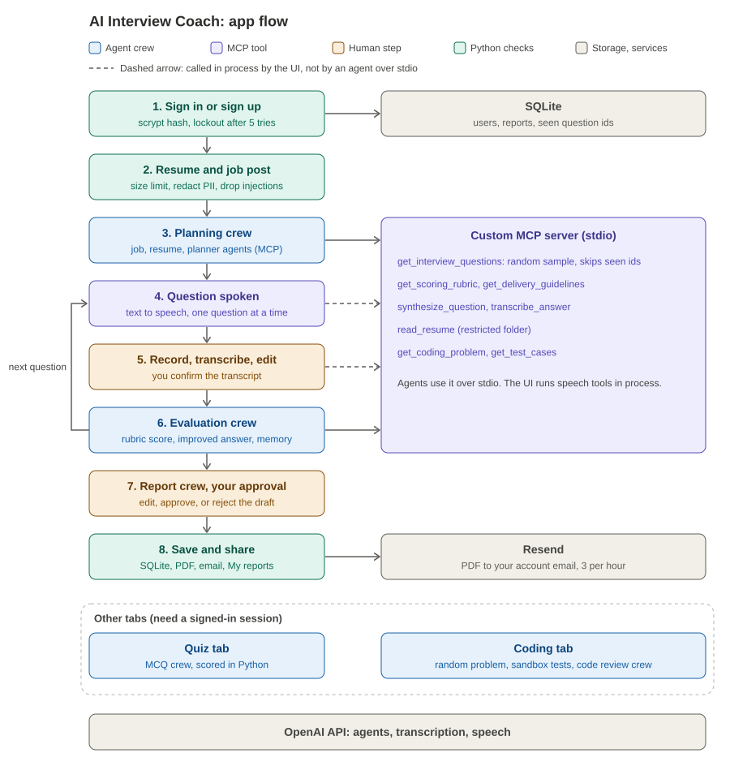

# AI Interview Coach

[Hugging Face Space](https://huggingface.co/spaces/abdelhadiOM/ai-interview-coach)

Multi-agent mock interview coach built with CrewAI and a custom MCP server. CS529 AI Engineering, Project 2, Maharishi International University.

## What it does

You sign in, upload a resume, and paste a job post. Agents analyze both and plan three questions from an MCP question bank. Each question is spoken. You record an answer, edit the transcript, and submit it. An evaluation agent scores it against an MCP rubric, explains each score with evidence, and writes an improved answer. After three answers a report agent drafts a report. You edit and approve it, then download it as Markdown or PDF, email it to yourself, or reopen it later under My reports. A quiz and a coding session use the same job profile.

## App flow



Diagrams in text form: [docs/architecture.md](docs/architecture.md)

## Features

- Accounts: sign up and sign in. Reports and seen questions are saved per account.
- Dynamic interviews: questions are a random sample from a 24-question MCP bank, skip questions you already saw, and are chosen to fit your resume and the job.
- Voice: spoken questions, recorded answers, and an editable transcript before scoring. Audio is deleted after transcription.
- Scoring: rubric dimensions with evidence, a Python-computed weighted score, filler word count, improved answers, and memory of earlier answers in the session.
- Knowledge quiz: multiple-choice questions from the skills in the job post, scored in Python.
- Coding session: random problem, sandboxed tests, hidden cases shown only as pass or fail, an AI code review, and a suggested solution shown only if it passes every test. Python by default.
- Report: edit, approve or reject, download as Markdown or PDF, email the PDF to your account address, and keep it under My reports.

## Agents and crews

| Crew        | Agents                                         | Runs               |
| ----------- | ---------------------------------------------- | ------------------ |
| Planning    | job analyst, resume analyst, interview planner | once per interview |
| Evaluation  | evaluation coach                               | once per answer    |
| Report      | evaluation coach                               | once at the end    |
| MCQ         | quiz writer                                    | on request         |
| Code review | code reviewer                                  | per review         |

Agents and tasks are defined in YAML under src/interview_coach/config. The interviewer agent and its follow-up task are defined but not used in the live flow.

## MCP server

One FastMCP server over stdio in mcp_server/server.py.

| Tool                               | Purpose                                                     |
| ---------------------------------- | ----------------------------------------------------------- |
| get_interview_questions            | random questions by category and level, skips excluded ids  |
| get_scoring_rubric                 | weighted dimensions per question type                       |
| get_delivery_guidelines            | time range and structure guidance                           |
| read_resume                        | read a resume from the restricted upload folder             |
| synthesize_question                | text to speech, saves an mp3 in the audio folder            |
| transcribe_answer                  | speech to text from the audio folder, then deletes the file |
| get_coding_problem, get_test_cases | coding data, hidden tests are never returned                |

Agents call the question and rubric tools over stdio. Each agent sees only the tools it needs. The speech functions live in this module and are exposed as MCP tools, and the UI calls them in process.

## Guardrails

- Input: file type and size, length limits, injection-line removal, email, phone and ID redaction with a privacy note in the UI.
- Output: Pydantic schemas, plan order and valid source ids, rubric dimension match, evidence in every score, no invented numbers in improved answers, valid quiz and code review.
- Tool: per-agent MCP allowlist, enum validation, path restrictions, code sandbox with AST screening, timeout and empty environment, rejected code never reaches the LLM, suggested solutions re-run before display.
- Account: scrypt hashing, lockout after 5 failed sign-ins, owner-only report access, email only to the account address with a limit of 3 per hour.

## Human in the loop

- Edit and confirm each transcript before it is scored.
- Edit, approve, or reject the final report. Saving, PDF and email happen only after approval.

## Memory and knowledge

- Session memory: earlier scores and gaps go into each new evaluation.
- Account memory: seen question ids are stored so a new interview picks different questions.
- Knowledge: the coach has an interview best-practices knowledge source. Set USE_KNOWLEDGE=0 to turn it off.

## Configuration

| Variable                   | Purpose                                                                                         |
| -------------------------- | ----------------------------------------------------------------------------------------------- |
| OPENAI_API_KEY             | Secret. LLM and speech                                                                          |
| MODEL                      | LLM name, default gpt-4o-mini                                                                   |
| RESEND_API_KEY, EMAIL_FROM | Email delivery                                                                                  |
| APP_DB_PATH                | SQLite path, default data/app.db                                                                |
| ENABLED_LANGUAGES          | python by default. Add javascript, csharp only on a trusted machine with the runtimes installed |
| USE_KNOWLEDGE              | 0 disables the coach knowledge source                                                           |

## Tests

```bash
pytest -q
```

Tests cover schemas, guardrails, MCP tools, the code runner, the coding pipeline, the quiz, accounts, PDF and email.

## Deployment

Hugging Face Space, Gradio SDK. Add OPENAI_API_KEY and RESEND_API_KEY as Space secrets, then push main to the Space remote.

## Known limits

- Space disk is not persistent, so accounts and saved reports reset when the Space restarts.
- Email addresses are not verified at sign up. Email goes only to the account address, 3 per hour.
- The Resend test sender delivers only to the Resend account owner until a domain is verified.
- The code sandbox is demo-grade, not container isolation. JavaScript and C# are off by default.
- Scores are practice estimates. The app does not assess accent, identity, or hiring suitability.

## Setup

```bash
python3.12 -m venv .venv && source .venv/bin/activate
pip install -r requirements.txt
cp .env.example .env   # add OPENAI_API_KEY
python app.py
```

## Team

| Role     | Owns                                                           |
| -------- | -------------------------------------------------------------- |
| Member 1 | crews, pipeline, guardrails, knowledge, quiz, dynamic planning |
| Member 2 | MCP server, speech tools, code runner, coding pipeline         |
| Member 3 | accounts, reports, email, UI, deployment                       |

## AI usage

See docs/ai-usage-log.md.
