# AI Interview Coach

[Hugging Face Space](https://huggingface.co/spaces/abdelhadiOM/ai-interview-coach)

Multi-agent mock interview coach built with CrewAI and a custom MCP server.

## What it does

User provides a resume and job post. Agents analyze both and plan questions via an MCP
question bank. Each question is spoken with synthesize_question. The user records one
answer, the MCP tool transcribe_answer turns it into text, and the user edits and
confirms that transcript. Scoring uses only the confirmed text, against an MCP rubric.
The user approves the final report before it is finalized.

## Architecture

Input guardrails -> Job Analysis + Resume Analysis -> Interview Planner (MCP)
-> Question audio (synthesize_question) -> Record one answer -> transcribe_answer
-> Edit and confirm transcript -> Evaluator/Coach (MCP rubric) -> HITL approval
-> Final report.
See docs/architecture.md.

## Agents

| Agent             | Responsibility                              |
| ----------------- | ------------------------------------------- |
| Job Analysis      | Skills, duties, seniority, interview themes |
| Resume Analysis   | Experience and evidence                     |
| Interview Planner | Calls MCP for questions                     |
| Interviewer       | Asks one question, follow-ups               |
| Evaluator/Coach   | Calls MCP rubric, scores, coaches           |

## MCP server

Tools: get_interview_questions, get_scoring_rubric, get_delivery_guidelines, read_resume,
transcribe_answer, synthesize_question.
Question and rubric tools are read-only. Speech tools accept only files inside the audio directory.

## Guardrails

Input: file type/size, PII warning, prompt-injection filter.
Output: Pydantic schema, feedback must cite the answer.
Tool: enum validation, path restriction.

## Architecture



## HITL

Edit and confirm each transcript before it is scored. Edit, approve, or reject the final report.

## Features

- Done: job and resume analysis, MCP question bank and rubric, question audio via synthesize_question, record one answer, transcribe with transcribe_answer, edit and confirm the transcript, score that text, improved answers, report approval and download.
- Done: coding session with Python, JavaScript, and C# execution at easy, medium, and hard levels.
- Done: knowledge quiz.
- Not done: login, email.

## Setup

```bash
python3.12 -m venv .venv && source .venv/bin/activate
pip install -r requirements.txt
cp .env.example .env   # add OPENAI_API_KEY
python app.py
```
