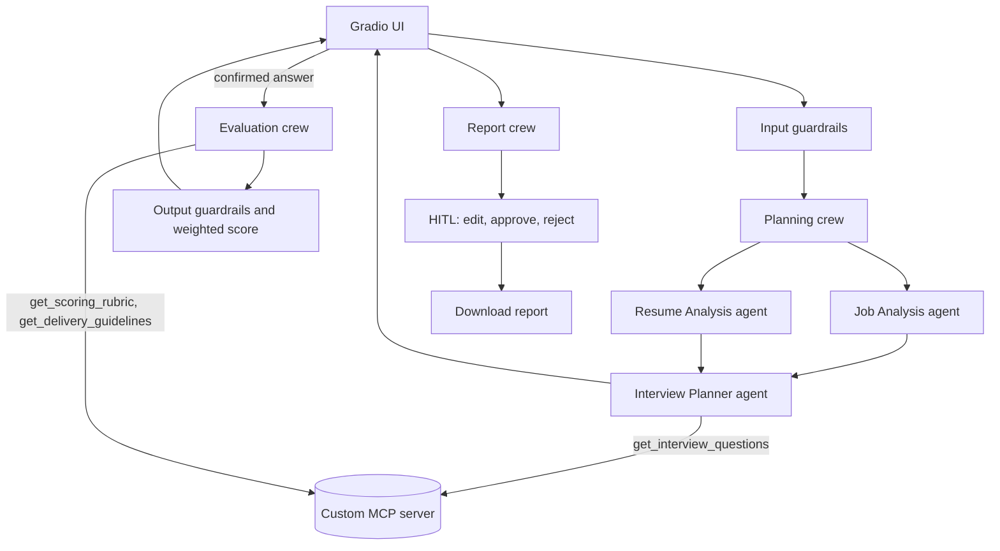

# Architecture

## Guardrails

- Input: length limits, injection-line removal, email/phone/ID redaction.
- Output: plan order, rubric dimension match, evidence notes, no invented numbers.
- Tool: per-agent MCP tool allowlist, server-side enums, resume path guard, code runner sandbox.

## Planned

Coding session, speech in and out, email report, sign up and login, MCQs.
