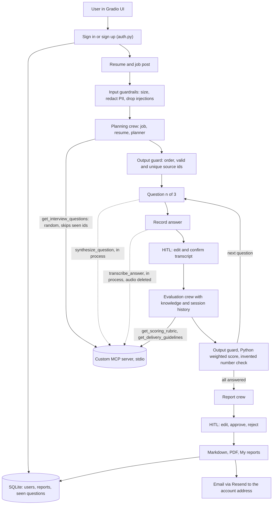
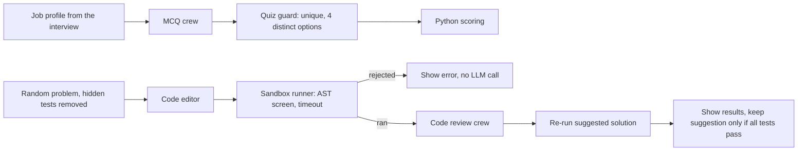

# Architecture

Picture of the full flow: [assets/interview_coach_app_flow.svg](../assets/interview_coach_app_flow.svg)

## Interview flow

## Quiz and coding flows

## Crews

| Crew           | Runs               | Agents                                         | MCP tools                                         | Output                                   |
| -------------- | ------------------ | ---------------------------------------------- | ------------------------------------------------- | ---------------------------------------- |
| PlanningCrew   | once per interview | job analyst, resume analyst, interview planner | get_interview_questions                           | JobProfile, ResumeProfile, InterviewPlan |
| EvaluationCrew | once per answer    | evaluation coach                               | get_scoring_rubric, get_delivery_guidelines       | AnswerEvaluation                         |
| ReportCrew     | once at the end    | evaluation coach                               | none                                              | FinalReport                              |
| MCQCrew        | on request         | quiz writer                                    | none                                              | MCQSet                                   |
| CodeReviewCrew | per code review    | code reviewer                                  | none, it receives the visible tests in the prompt | CodeEvaluation                           |

The interviewer agent and the follow-up task are defined in the YAML files. The live flow does not call them yet.

## MCP server

One FastMCP server over stdio. Each agent sees only the tools it needs through a tool filter.

| Tool                               | Used by          | Notes                                                      |
| ---------------------------------- | ---------------- | ---------------------------------------------------------- |
| get_interview_questions            | planner agent    | random sample from a 24-question bank, skips excluded ids  |
| get_scoring_rubric                 | evaluation coach | weighted dimensions per question type                      |
| get_delivery_guidelines            | evaluation coach | time range and structure                                   |
| read_resume                        | available        | restricted upload folder                                   |
| synthesize_question                | UI, in process   | text to speech, capped at 600 characters, old files purged |
| transcribe_answer                  | UI, in process   | audio folder only, file deleted after use                  |
| get_coding_problem, get_test_cases | available        | hidden tests are never returned                            |

The speech functions live in the MCP server module and are exposed as MCP tools. The UI imports and calls them in process. Agents use the same server over stdio for questions and rubrics.

## Guardrails

- Input: length limits, injection-line removal, email, phone and ID redaction, resume file type and 2 MB limit.
- Output: plan order, source ids exist and are unique, rubric dimension match, evidence notes of 4 words or more, improved answer length, no invented numbers, complete report, valid quiz, valid code review.
- Tool: per-agent MCP allowlist, server-side enums, resume and audio path guards, code sandbox with AST screen, timeout and empty environment, hidden tests never exposed, suggested solutions re-run before display.
- Account: scrypt password hashing, lockout after 5 failures, reports read with an owner filter, email only to the account address, 3 per hour.

## Data stores

| Store                | Holds                                   | Lifetime                           |
| -------------------- | --------------------------------------- | ---------------------------------- |
| SQLite (APP_DB_PATH) | users, saved reports, seen question ids | resets when the Space restarts     |
| tmp/audio            | question audio and recordings           | purged after use or after one hour |
| gr.State             | current session, signed-in user         | per browser tab                    |

## Not done

Nothing planned for the demo. Limits are listed in the README.
